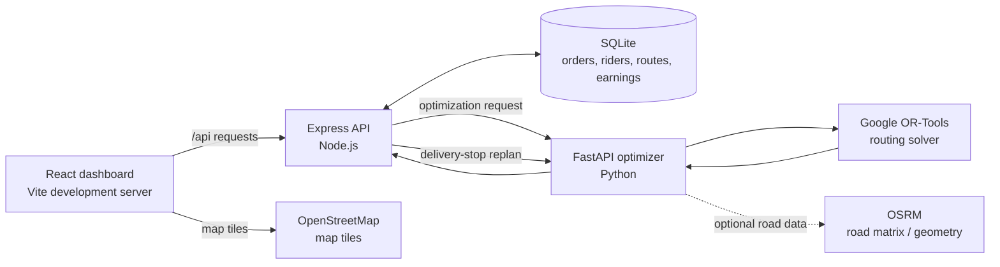

<p align="center">
  
</p>

<h1 align="center">Intelligent Delivery Route Optimization System</h1>

<p align="center">
  A full-stack food-delivery operations demo for order dispatch, rider workflows, and multi-stop route planning around Greater Noida.
</p>

<p align="center">
  
  
  
  
  
</p>

## What this project does

This repository contains a runnable local demonstration of a food-delivery dispatch system. Dispatchers can review orders and fleet availability, generate route proposals, and apply a selected proposal. Riders can view available deliveries, compare estimated solo earnings, preview a route, accept orders, and confirm pickup and delivery stops.

The browser UI is a React single-page application. An Express API owns order and rider state in SQLite. A separate FastAPI service uses Google OR-Tools to solve pickup-and-delivery routing problems. When configured, OSRM supplies road distances, durations, route geometry, and turn-by-turn steps.

> **Scope:** This is an academic/local demo, not a production delivery platform. It does not provide customer checkout, payment processing, authentication, or production hosting. Demo payout amounts and fallback road distances are estimates.

## Contents

- [Features](#features)
- [Architecture and request flow](#architecture-and-request-flow)
- [Route optimization](#route-optimization)
- [Technology stack](#technology-stack)
- [Repository layout](#repository-layout)
- [Requirements](#requirements)
- [Run locally](#run-locally)
- [Configuration](#configuration)
- [Demo data and persistence](#demo-data-and-persistence)
- [HTTP API reference](#http-api-reference)
- [Tests and build](#tests-and-build)
- [Troubleshooting](#troubleshooting)
- [Known limitations](#known-limitations)

## Features

### Dispatcher dashboard

- Operations overview with current order counts and fleet availability.
- Live map with restaurants, delivery agents, active orders, and route proposals.
- Order list and status updates, plus restaurant and rider directories.
- Four route proposal objectives: distance, time, profit-oriented, and balanced.
- Optimization history. A proposal is stored separately and does not assign orders until **Apply proposal** is selected.
- Analytics for persisted order counts and delivered-order revenue. The historical daily chart is illustrative and labeled as such.
- Demo reset action to restore the seeded dataset.

### Rider dashboard

- Rider profile selection and per-rider online/offline shift tracking.
- Available deliveries sorted by estimated solo take-home amount.
- Select one order or bundle up to four orders, then preview the optimized pickup/drop sequence and estimated payout before accepting.
- Accepted trip view with pickup and delivery stops, route guidance, and map navigation.
- Confirmation controls for pickups and deliveries; completing a delivery replans the remaining customer stops.
- Dashboard metrics for completed deliveries, working time, estimated earnings, and route distance.

### Routing and maps

- Road distance and travel-time matrices use OSRM when it responds with a valid matrix.
- If OSRM is unavailable, the optimizer labels its estimate as simulated and uses a straight-line distance multiplied by a road factor. It does not draw invented road geometry or turn instructions.
- The frontend uses OpenStreetMap tiles. Internet access is needed to load map tiles and to use public OSRM endpoints.

## Architecture and request flow



### Service responsibilities

| Component | Responsibility | Local address |
| --- | --- | --- |
| Vite + React | Dispatcher and rider user interfaces; proxies `/api` requests to the API | `http://127.0.0.1:5173` |
| Express | REST API, validation of state transitions, SQLite persistence, and orchestration of the optimizer | `http://127.0.0.1:4000` |
| FastAPI | Validates optimization inputs and exposes route-solving endpoints | `http://127.0.0.1:8000` |
| SQLite | Stores demo restaurants, agents, orders, optimization runs, rider offers, routes, and earnings | `backend/data/delivery.sqlite` by default |
| OSRM | Optional road distance/time matrix and road geometry provider | Public demo URL by default; configurable |

### Typical dispatcher flow

1. Review pending orders and available agents.
2. Choose the orders and agents to include in a route-optimization request.
3. Select an objective and run the optimizer.
4. Inspect the returned routes, stops, distances, times, and estimates.
5. Apply the proposal to persist assignments. Until applied, the proposal remains separate from the order assignments.

### Typical rider flow

1. Go online and inspect the available delivery offers.
2. Select up to four offers and preview the proposed trip and estimated take-home pay.
3. Accept the trip to create the rider route and assignments.
4. Confirm each restaurant pickup and then each customer delivery.
5. The remaining delivery stops are reordered from the last completed customer stop.

## Route optimization

The optimizer models each delivery as a **pickup at a restaurant followed by delivery to a customer**. OR-Tools searches for routes across the available agents while enforcing the hard constraints below:

- The same agent must handle an order's pickup and delivery.
- Pickup must occur before delivery.
- Vehicle capacity must not be exceeded.
- Route duration must fit within the agent's shift limit.
- Delivery must fit within the order's configured delivery window.
- Unavailable agents are excluded.

The API accepts `distance`, `time`, `profit`, and `balanced` strategies:

| Strategy | Solver objective |
| --- | --- |
| `distance` | Minimize the road-distance matrix cost. |
| `time` | Minimize travel and service time. |
| `profit` | Use configured distance operating cost, time penalty, and fixed agent incentive in the objective. Revenue, operating cost, and estimated profit are also reported in the result. |
| `balanced` | Combine distance and time costs and add a global route-span cost to encourage balanced workloads. |

The solve time is configurable per request, bounded by the request schema. As with other heuristic vehicle-routing problems, a solution is an optimized proposal within the configured constraints and time limit, not a guarantee of a globally optimal real-world route.

Rider offer estimates use configurable demo rates. The displayed solo estimate and the final bundled-trip estimate are not guaranteed earnings or a payment calculation.

## Technology stack

| Area | Technologies |
| --- | --- |
| Web UI | React 18, JavaScript, Vite 6, CSS |
| Maps | Leaflet, React-Leaflet, OpenStreetMap tiles |
| Charts and icons | Recharts, Lucide React |
| API | Node.js, Express 5 |
| Database | SQLite via Node.js built-in `node:sqlite` |
| Optimization API | Python, FastAPI, Pydantic, Uvicorn |
| Routing solver | Google OR-Tools |
| Road network data | OSRM (optional) |
| Tests | Node.js built-in test runner, pytest |

## Repository layout

```text
.
|-- backend/
|   |-- server.js                 # Express API, SQLite schema, seed data, routes
|   |-- data/                     # Local SQLite database (ignored by Git)
|   `-- test/api.test.js           # API integration tests
|-- frontend/
|   |-- index.html
|   `-- src/
|       |-- App.jsx                # Dispatcher and rider application
|       |-- main.jsx               # React entry point
|       |-- styles.css             # Main UI styles
|       `-- rider-map.css          # Rider and map styles
|-- optimization-engine/
|   |-- app/
|   |   |-- main.py                # FastAPI endpoints
|   |   |-- optimizer.py           # OR-Tools pickup/delivery solver
|   |   |-- routing.py             # OSRM integration and fallback estimates
|   |   `-- schemas.py             # Pydantic request schemas and validation
|   |-- requirements.txt
|   `-- tests/test_optimizer.py    # Optimizer tests
|-- scripts/run-optimizer.js       # Starts Uvicorn with the selected Python
|-- .env.example                   # Local configuration template
|-- package.json                   # Workspace scripts
`-- README.md
```

## Requirements

- **Node.js 22.5 or newer** (Node.js 24 is recommended). The API uses the built-in `node:sqlite` module.
- **Python 3.10 or newer**.
- Internet access for package installation and OpenStreetMap tiles. OSRM routing is optional; the application falls back to labeled estimates.

Docker and PostgreSQL are not required for this local demo. The default database is SQLite; this repository does not include a PostgreSQL/PostGIS production deployment.

## Run locally

### Windows PowerShell

Run these commands from the repository root:

```powershell
Copy-Item .env.example .env
py -3 -m venv .venv
.\.venv\Scripts\python.exe -m pip install -r optimization-engine\requirements.txt
npm install
npm run dev
```

Open the Vite URL printed in the terminal, normally `http://127.0.0.1:5173`. The root `npm run dev` command starts the API, optimizer, and web application together. Use `Ctrl+C` in that terminal to stop them.

### macOS or Linux

```bash
cp .env.example .env
python3 -m venv .venv
.venv/bin/python -m pip install -r optimization-engine/requirements.txt
npm install
npm run dev
```

### Run services separately

The root launcher is recommended because it starts all services. For debugging, start each process in a separate terminal from the repository root:

```bash
npm run dev --workspace backend
npm run optimizer
npm run dev --workspace frontend
```

The optimizer launcher uses `.venv` when available. Set `PYTHON_BIN` if Python is installed at a different location.

## Configuration

Copy `.env.example` to `.env` before changing local settings. The root launch scripts load this file. Never commit real credentials or private endpoint tokens.

| Variable | Default | Description |
| --- | --- | --- |
| `API_PORT` | `4000` | Express API port. |
| `OPTIMIZER_PORT` | `8000` | Uvicorn optimizer port. |
| `OPTIMIZER_URL` | `http://127.0.0.1:8000` | URL used by the API to call the optimizer. |
| `DATABASE_PATH` | `data/delivery.sqlite` | SQLite path, normally resolved from the backend working directory. |
| `OSRM_BASE_URL` | `https://router.project-osrm.org` | OSRM service base URL. Set to an empty value to skip OSRM and use simulated distance/time estimates. |
| `WEB_ORIGIN` | `http://127.0.0.1:5173` | Browser origin allowed by the local API CORS middleware. |
| `RIDER_BASE_FARE` | `24` | Demo rider payout base amount. |
| `RIDER_PAY_PER_BILLABLE_KM` | `8` | Demo payout per billable restaurant-to-customer kilometer. |
| `RIDER_DROP_BONUS` | `12` | Demo payout per drop. |
| `RIDER_PRIORITY_BONUS` | `8` | Demo bonus for high-priority orders. |
| `RIDER_FUEL_COST_PER_KM` | `2.5` | Estimated fuel cost per kilometer of the full trip. |
| `PYTHON_BIN` | auto-detected | Optional Python executable used by `scripts/run-optimizer.js`. |

The public OSRM demo service is best-effort and rate-limited. Use a self-hosted OSRM endpoint for regular use.

## Demo data and persistence

A fresh database is seeded with **5 restaurants, 10 delivery agents, and 30 orders** in Greater Noida. The fresh seed includes **20 pending orders**, 8 delivered orders, and 2 cancelled orders.

The SQLite database persists across API restarts. On an existing database, a one-time migration adds enough pending demo offers to bring the available pool to 20; it does not delete or rewrite existing order history. Consequently, an upgraded database can contain more than the fresh-seed total of 30 orders. The demo reset action intentionally clears demo operational records and re-seeds the dataset.

SQLite database files and local environment files are excluded from Git. Do not commit a local database that may contain test or operational data.

## HTTP API reference

All API routes below are prefixed with `/api`. The frontend development server proxies that prefix to the Express service.

### Express API

| Method | Path | Purpose |
| --- | --- | --- |
| `GET` | `/health` | API/database health information. |
| `GET` | `/overview` | Current order, revenue, and fleet summary. |
| `GET` | `/orders` | List orders; accepts a `status` query filter. |
| `GET` | `/restaurants` | List restaurants. |
| `GET` | `/agents` | List riders and active-order counts. |
| `GET` | `/rider/:agentId/dashboard` | Rider profile, shift, delivery, and earnings statistics. |
| `POST` | `/rider/:agentId/availability` | Change a rider's online status. |
| `GET` | `/rider/:agentId/available-orders` | List pending offers with solo estimates. |
| `POST` | `/rider/:agentId/preview` | Optimize and price a rider-selected bundle without accepting it. |
| `POST` | `/rider/offers/:offerId/accept` | Accept an offer and persist assignments and route. |
| `GET` | `/rider/:agentId/route` | Retrieve the rider's active route. |
| `POST` | `/rider/:agentId/orders/:orderId/confirm-delivery` | Confirm a picked-up order as delivered and replan remaining drops. |
| `PATCH` | `/orders/:id/status` | Update a supported order status and associated route state. |
| `POST` | `/optimization/run` | Run an operations route proposal. |
| `GET` | `/optimization/history` | List saved optimization runs. |
| `GET` | `/optimization/:id` | Retrieve a saved optimization proposal. |
| `POST` | `/optimization/:id/apply` | Apply a saved proposal to order assignments. |
| `POST` | `/admin/reset-demo` | Clear demo operational data and re-seed it. |

### Optimization service

| Method | Path | Purpose |
| --- | --- | --- |
| `GET` | `/health` | Optimizer health check. |
| `POST` | `/optimize/{strategy}` | Solve a multi-agent pickup-and-delivery problem; strategy is `distance`, `time`, `profit`, or `balanced`. |
| `POST` | `/route/delivery-sequence` | Reorder up to 20 remaining customer stops from a rider's current location. |

The optimizer API uses Pydantic schemas for coordinate bounds, positive capacities, unique IDs, delivery windows, and valid strategy inputs. Its interactive OpenAPI documentation is available at `http://127.0.0.1:8000/docs` while the optimizer is running.

## Tests and build

Run the backend API integration tests and frontend production build from the repository root:

```bash
npm test
npm run build
```

Run the optimizer unit tests:

### Windows PowerShell

```powershell
Push-Location optimization-engine
..\.venv\Scripts\python.exe -m pytest -q
Pop-Location
```

### macOS or Linux

```bash
cd optimization-engine
../.venv/bin/python -m pytest -q
cd ..
```

The API tests use a temporary SQLite database and a local test optimizer, so they do not modify the normal demo database or require a live OSRM service.

## Troubleshooting

- **`node:sqlite` is unavailable:** install Node.js 22.5 or newer; Node.js 24 is recommended.
- **Python or Uvicorn does not start:** recreate `.venv`, install `optimization-engine/requirements.txt`, and check `PYTHON_BIN` if using a non-default interpreter.
- **A port is already in use:** stop the process using port `5173`, `4000`, or `8000`, or update the relevant environment setting and the frontend proxy as needed.
- **The map is blank:** check internet access and browser network errors for OpenStreetMap tile requests.
- **Routes show simulated estimates:** OSRM may be unreachable, rate-limited, or disabled. Check `OSRM_BASE_URL`; the estimate fallback is labeled in the UI and does not fabricate road geometry.
- **Available-order count differs after an update:** restart the API so its one-time SQLite migration can run, then refresh the browser. The migration preserves existing records.
- **Rider payout looks different for a bundle:** the solo estimate is recalculated by the optimizer when the selected bundle is previewed. All payout values are demo estimates.

## Known limitations

- No customer-facing ordering or checkout flow, payments, authentication, or role-based access control.
- No production deployment, job queue, realtime WebSocket updates, or PostgreSQL/PostGIS setup.
- SQLite and seeded local data are intended for a single-machine demo, not concurrent production traffic.
- Public OSRM and OpenStreetMap endpoints have their own availability, usage policies, and rate limits.
- Rider earnings, fuel costs, road fallbacks, and historical chart data are illustrative estimates.
- No open-source license is currently specified in this repository.
